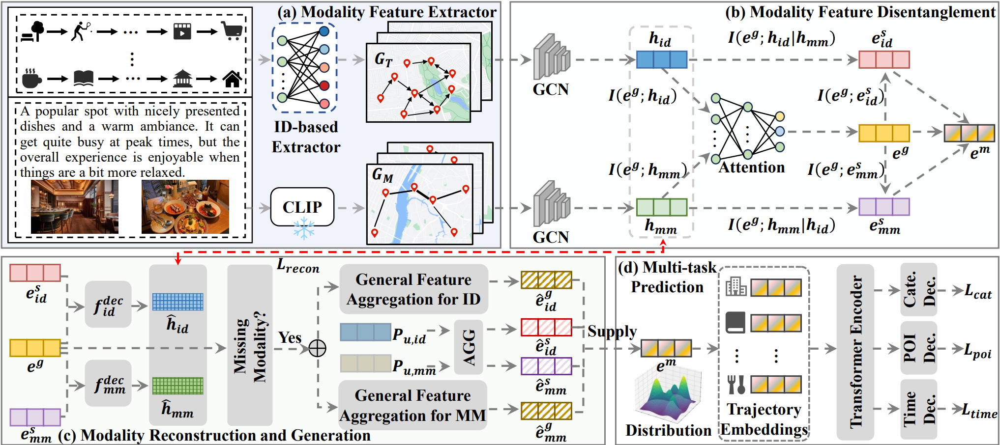

<div align="center">

# 🗺️ RoPOI
### Robust POI Recommendation via Modality Disentanglement & Missing Representation Generation

<p align="center">
  
  
  
  
</p>

<p align="center">
  
  
</p>

> 📄 PyTorch implementation of **"RoPOI: Robust POI Recommendation based on Modality Disentanglement and Missing Representation Generation"**

</div>

---

## 🏗️ Framework

<div align="center">

</div>

---

## ✨ Highlights

- 🔀 **Modality Disentanglement** — Information Bottleneck-based general/specific feature decoupling
- 🧩 **Missing Modality Generation** — Robust reconstruction under incomplete multimodal inputs
- 📍 **POI Recommendation** — Sequential trajectory modeling with geo-aware graph embeddings
- ⚡ **Efficient Training** — GatedGraphConv + Transformer encoder architecture

---

## 🛠️ Requirements

```shell
# Create & activate environment
conda create --name RoPOI python=3.9.23
conda activate RoPOI

# Install PyTorch (CUDA 11.8)
pip install torch==2.7.1+cu118 --index-url https://download.pytorch.org/whl/cu118

# Install PyTorch Geometric
pip install torch_geometric==2.6.1

# Install other dependencies
conda install numpy==1.26.4 pandas==2.3.2 tqdm==4.58.0
pip install scikit-learn==1.0.2
```

---

## 🚀 Quick Start

### 1. Prepare Data

```shell
cd RoPOI-main
```

- 📦 Download dataset: [NYC.zip](https://drive.google.com/file/d/1xLXcRriNpMF9rAqsQOc4csjJBAeBuziP/view?usp=sharing) → unzip to `data/NYC/`

### 2. Build Graphs

```shell
python build_graph.py
```

### 3. Train

```shell
python run.py
```

> All hyper-parameters are defined in `param_parser.py`

### 4. Test

```shell
python run.py --test_only --checkpoint RoPOI_best_20260415_152057.pth
```

- 💾 Download checkpoint: [RoPOI_best.pth](https://drive.google.com/file/d/1T83jRs-iGZ6zEDNhpKZpJXMYQFOnBY2A/view?usp=sharing)

---

## 📊 Datasets

| Dataset | Link |
|---------|------|
| NYC  | [Download](https://sites.google.com/site/yangdingqi/home/foursquare-dataset) |
| TKY  | [Download](https://sites.google.com/site/yangdingqi/home/foursquare-dataset) |
| NOLA | [Download](https://www.yelp.com/dataset) |

---

<div align="center">
Thank you for your attention to this implementation! 🙏
</div>
